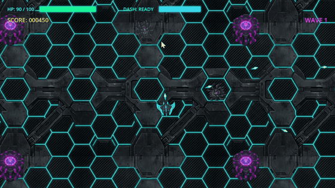

# Godot MCP

[](https://github.com/SrDarkoll/godot-mcp/actions/workflows/ci.yml)
[](LICENSE)
[](https://godotengine.org)
[](https://nodejs.org)
[](https://www.typescriptlang.org)
[](docs/architecture/tool-registry-profiles.md)
[](https://github.com/SrDarkoll/godot-mcp)
[](https://www.npmjs.com/package/@srdarkx/godot-mcp)

> **Give your AI coding assistants hands, eyes, and deep debugging powers directly inside Godot Engine 4.x.**

Godot MCP is an open-source [Model Context Protocol (MCP)](https://modelcontextprotocol.io/) server that connects modern AI assistants (Codex, Anthropic Claude Desktop, Cursor, Antigravity, Roo Code, Cline, and custom agents) directly to Godot. The verified runtime target is **Windows with Godot 4.6.3**; other Godot 4.x minors need their own integration evidence.

Instead of copying and pasting GDScript snippets, guessing node hierarchy paths, or struggling to describe visual bugs to an LLM, Godot MCP provides a bidirectional control plane: agents can inspect scene trees, author 2D/3D nodes, build TileMaps, edit animations, step through code with a live DAP debugger, and capture high-resolution viewport screenshots for visual grounding.

---

## Current release: 0.6.5

The public npm package, MCP server and Godot addon are aligned at **0.6.5**, with **protocol 1** and **194 tools**.

- Routine project settings and headless work use the existing session permissions without redundant approval prompts.
- Closing a named scene saves it first; discarding unsaved changes remains protected.
- GDScript inspection reads fresh disk source without reloading live instances.
- The complete Windows runtime bundle includes the startup fixes delivered in 0.6.4.

See the [0.6.5 release notes](docs/releases/0.6.5.md), [0.6.4 release notes](docs/releases/0.6.4.md) and [changelog](CHANGELOG.md).

To update, run these commands from **each Godot project folder**:

```powershell
npm install -g @srdarkx/godot-mcp@latest
godot-mcp upgrade --dry-run
godot-mcp upgrade
godot-mcp doctor
```

Updating npm alone does not update project addons or pinned client launchers. The upgrade flow migrates recognized Codex entries. For Cursor, Antigravity or Claude Desktop, also rerun the matching `godot-mcp init --client <name>` command after the upgrade and before reconnecting the client. Reload the addon in an already-open Godot editor. See [client setup and verification](docs/tools/clients.md) for the exact scopes and limitations.

---

## Built with Godot MCP & Gemini 3.8 Flash



*NEON SWARM* is a fast-paced 2D cyberpunk top-down survival game created 100% autonomously by **Gemini 3.8 Flash** using **Godot MCP**—covering scene assembly, GDScript authoring, procedural audio, original artwork, and live DAP interactive debugging.

---

## Key Highlights & Superpowers

- 🎮 **Complete Editor & Scene Control**: Programmatically inspect, create, reparent, modify, and delete nodes, scenes, resources, and script signals without breaking scene structure.
- 🐞 **Interactive DAP Debugger (Phase 9)**: Real-time breakpoint management, stepping (into, over, out), call stack inspection, and lazy variable evaluation during live game execution.
- 👁️ **Visual Grounding & Viewport Capture**: Capture 2D and 3D editor viewports as well as running game frames as PNGs, enabling multimodal AI models to visually inspect level layouts, shaders, and lighting.
- ⚡ **Headless Process Manager (Phase 8)**: Run project validation, asset importing, automated tests, and background game instances without GUI dependencies—ideal for autonomous CI/CD or agent self-testing.
- 🛡️ **Recoverable File Transactions**: `transaction.*` stages declared files, checks preconditions and retains a journal and snapshots for compensation or manual recovery after a failed publication.
- 🧩 **Structured Scene Batches**: Prevalidate up to 64 native scene/resource operations, reject stale state, then apply them as one Undo/Redo action.
- 🔄 **Project Events & Dependency Impact**: Resume bounded project event streams and inspect direct, transitive, broken, and inbound resource references before changing assets.
- 📊 **Deterministic Regression Evidence**: Compare retained viewport captures pixel by pixel and evaluate runtime snapshots against caller-defined performance budgets.
- 📐 **Walkway Geometry Preflight**: Check complete 2D route footprints against declared colliders and measure endpoint gaps before running the game.
- 🎯 **8 Bounded Tool Profiles**: Select focused toolsets (`minimal`, `core`, `2d`, `3d`, `navigation`, `ui`, `runtime`, `full`) to drastically reduce LLM context token usage and latency.

---

## Architecture Overview

Godot MCP uses a decoupled, secure two-tier architecture communicating over standard MCP stdio on the client side and an authenticated loopback WebSocket (`127.0.0.1`) on the engine side.

```text
┌─────────────────────────────────────────────────────────────┐
│             AI Client (Codex, Claude, Cursor, Antigravity)  │
└──────────────────────────────┬──────────────────────────────┘
                               │ MCP Protocol (stdio / JSON-RPC)
                               ▼
┌─────────────────────────────────────────────────────────────┐
│                  Godot MCP Server (Node.js 22+)             │
│  ├─ Tool Registry (194 tools across 8 profiles)             │
│  ├─ Headless Process Manager (Godot CLI runner)             │
│  ├─ DAP Client (Interactive debugger bridge)                │
│  ├─ Transaction & Snapshot Recovery Engine                  │
│  └─ Loopback WebSocket Server (127.0.0.1:<dynamic-port>)     │
└──────────────────────────────┬──────────────────────────────┘
                               │ Authenticated Handshake (Token)
                               ▼
┌─────────────────────────────────────────────────────────────┐
│                    Godot 4.x Engine Instance                │
│  ├─ EditorPlugin (addons/godot_mcp)                         │
│  ├─ SceneTree & Resource Mutator                            │
│  ├─ 2D & 3D Viewport Grabbers                               │
│  └─ Runtime Autoload & Diagnostics Bridge                   │
└─────────────────────────────────────────────────────────────┘
```

---

## Enterprise Hardening & Safety Architecture

Godot MCP includes bounded checks and recovery controls for autonomous work in trusted Godot projects:

- 🔒 **Kernel-Level Project Lease (`project-lease.ts`)**: Multi-process mutual exclusion via Windows Named Pipes (`\\.\pipe\godot-mcp-project-<sha256>`). Ensures only one server or CLI process modifies a project concurrently, with automatic instant cleanup by the OS kernel if a process terminates abnormally.
- 🔄 **Addon Journal & Rollback Barrier (`addon-journal.ts`)**: Addon installations and updates are staged with SHA-256 integrity verification. Startup detects a pending update and attempts rollback before normal work; an invalid journal or failed rollback stops the operation for inspection.
- 📦 **Defensive Memory & Recursion Budgets (`argument-budget.ts`, `serialization_budget.gd`)**: Bound accepted inputs and serialized results; they reduce resource exhaustion but cannot sandbox project code.
- 🛡️ **Reflection Guardrails (`reflection-safety.ts`, `safety_policy.gd`)**: Block dangerous reflective methods and restrict node mutations to the active edited scene tree; Godot and project scripts still run with their normal OS privileges.
- 📝 **Journalled Multi-File Transactions & Checkpoints (`transaction.*`, `checkpoint.*`)**: Publish files sequentially with preconditions and compensation. An unsuccessful compensation retains evidence and requires recovery. External processes can observe intermediate files.
- 🐞 **Interactive DAP Debugger (`debug.*`)**: Real-time breakpoints, stepping (into, over, out), stack frame inspection, and lazy variable expansion during live game runs.
- ⚡ **Headless Process Manager (`headless.*`)**: Run project validations, asset imports, and automated tests in headless mode without GUI dependencies.
- 👁️ **Visual Grounding (`visual.*`)**: High-resolution PNG captures of 2D/3D editor viewports and running game frames.

---

## Tool Profiles

To keep LLM context sizes bounded, Godot MCP divides its 194 tools into 8 specialized profiles:

| Profile | Tools | Primary Focus | Included Capabilities |
| :--- | :---: | :--- | :--- |
| `minimal` | 5 | Liveness & Discovery | Session status, project info, scene tree, engine capabilities, tool registry |
| `core` | 86 | Project & Scene CRUD | Project info, scene tree, nodes, resources, batches, geometry, dependencies, transactions |
| `2d` | 130 | 2D Game Development | Core + Node2D, Sprite2D, TileMapLayer, TileSet, Camera2D, Collision2D, Parallax2D |
| `3d` | 115 | 3D World Building | Core + Node3D, Mesh3D, Camera3D, Collision3D, Light3D, StandardMaterial3D, Shader3D |
| `navigation` | 75 | Navigation & Pathfinding | NavigationRegion/mesh/agent workflows and 2D geometry preflight |
| `ui` | 89 | User Interface & Animation | Control layout, focus, animation and visual capture |
| `runtime` | 53 | QA, Headless & Debugging | Headless runner, live game inspection, events, visual and performance comparison, DAP debugger |
| `full` | 194 | Complete | All available Godot MCP tools (default) |

> **Tip:** You can set a default profile in `.godot-mcp/config.json` via `godot-mcp config <project> --tool-profile 2d` or override it on server start with `--tool-profile <name>`.

---

## Requirements & Compatibility Boundary

- **Operating System:** Windows 10/11 is the supported runtime. The project lease currently rejects Linux and macOS at server/CLI initialization with `UNSUPPORTED_PLATFORM`.
- **Godot Engine:** Verified against **Godot 4.6.3-stable** on Windows. Other Godot 4.x releases have capability probes but lack the complete integration matrix.
- **Node.js:** v22.0.0 or newer.
- **Package Manager:** npm (bundled with Node.js).

---

## Setup

### 1. Create the project in Godot

Create or open your game in Godot, then close the editor while you install the addon.

### 2. Install the command once

With Node.js 22+ installed, open CMD or PowerShell and run:

```powershell
npm install -g @srdarkx/godot-mcp@latest
```

### 3. Open a terminal in your project folder

In File Explorer, open the folder containing `project.godot`. Right-click inside the folder and select **Open in Terminal**, or open CMD/PowerShell there.

### 4. Configure your client

Run the command for the client you use:

| Client | Command |
| --- | --- |
| Codex | `godot-mcp init --client codex` |
| Cursor | `godot-mcp init --client cursor` |
| Antigravity | `godot-mcp init --client antigravity` |
| Claude Desktop | `godot-mcp init --client claude` |

For Gemini CLI, Roo Code or Cline, follow the [client guide](docs/tools/clients.md#manual-clients).

### 5. Open your AI client

- **Codex:** add the project folder and mark it as trusted.
- **Cursor or Antigravity:** open the project folder and enable Godot MCP in the client's MCP settings if prompted.
- **Claude Desktop:** completely quit and reopen the app.

If the client was already open during installation, reload its MCP connection or restart it.

### 6. Reopen the project in Godot

Open the same `project.godot` you used in step 3. The client starts the MCP server automatically.

### 7. Check the connection

Start a chat in your AI client and send:

> Use Godot MCP to check the connection. Show me the project path and whether the Godot editor is connected. Do not modify the project.

The path should match your project and the editor should be connected. You can then start working on the game.

### Troubleshooting

| Symptom | Check or fix |
| --- | --- |
| `godot-mcp` is not recognized | Reopen the terminal after step 2. If it still fails, check npm's global executable directory is on PATH. |
| `project.godot` is missing | Open the terminal in the folder containing that file, or pass the project path to `init`. |
| Godot executable not detected | Add `--godot "C:\Tools\Godot.exe"` to your setup command, using your executable's path. |
| Server configured but editor disconnected | Reload the client and reopen the same Godot project; inspect addon warnings and the live connection state. |
| Codex selects another project | For projects without Git, run `godot-mcp setup codex --register-project-root` and reconnect Codex. This updates Codex user configuration with a backup; see the [Codex guide](docs/tools/codex.md). |
| Runtime disconnected | Expected before a scene is running. Use F6 to run a scene; F5 requires a main scene. |

For a diagnostic report, run `godot-mcp doctor` in the project folder. Godot itself can be installed elsewhere; the project folder is identified by `project.godot`.

### Without global installation

Use `npx` instead:

```powershell
npx --yes @srdarkx/godot-mcp@latest init --client codex
npx --yes @srdarkx/godot-mcp@latest doctor
```

Replace `codex` with your client name, then continue at step 5.

---

### Alternative: Build from Source (Contributors)

```powershell
git clone https://github.com/SrDarkoll/godot-mcp.git
cd godot-mcp
npm install
npm run build
```

---

## Client Configuration

Add Godot MCP to your preferred AI assistant configuration:

### Codex

`godot-mcp init --client codex` writes a managed server entry to the project's `.codex/config.toml`. Generated launchers pin the installed version so the server and addon remain aligned; the current release produces:

```toml
[mcp_servers.godot-mcp]
command = "npx"
args = ["--yes", "@srdarkx/godot-mcp@0.6.5", "start", "C:/path/to/YourGodotProject", "--tool-profile", "full"]
```

Codex CLI, IDE extension, and local desktop tasks share the configuration on the same host. Trust the project and restart Codex after configuration changes. From that project, `codex mcp get godot-mcp --json` shows the configured launch command and project path; `/mcp` shows the active connection. The local `setup codex` recipe in the [Codex guide](docs/tools/codex.md) is also available for source development. See [OpenAI's MCP configuration guide](https://learn.chatgpt.com/docs/extend/mcp) for the client-side format.

### Claude Desktop

Run `godot-mcp init --client claude`, then fully quit and reopen Claude Desktop. It writes `%APPDATA%\Claude\claude_desktop_config.json`, preserving other server entries and backing up an existing file. This is local STDIO, not a remote connector URL or Claude Code configuration. See [Anthropic's connection/status instructions](https://support.claude.com/en/articles/10949351-getting-started-with-local-mcp-servers-on-claude-desktop) and the [official local-server setup example](https://modelcontextprotocol.io/docs/develop/connect-local-servers).

The managed entry targets one absolute Godot project. Initializing another project for Desktop replaces that managed target with a backup; it does not follow whichever Godot window is active. For simultaneous projects, configure separately named entries and confirm which project each tool controls.

```json
{
  "mcpServers": {
    "godot-mcp": {
      "command": "npx",
      "args": [
        "--yes",
        "@srdarkx/godot-mcp@0.6.5",
        "start",
        "C:\\path\\to\\YourGodotProject",
        "--tool-profile",
        "full"
      ]
    }
  }
}
```

### Cursor

Run `godot-mcp init --client cursor` from the project root. Cursor reads `.cursor/mcp.json`; its [official MCP documentation](https://cursor.com/docs/mcp) describes local STDIO entries and configuration scopes.

```json
{
  "mcpServers": {
    "godot-mcp": {
      "type": "stdio",
      "command": "npx",
      "args": [
        "--yes",
        "@srdarkx/godot-mcp@0.6.5",
        "start",
        "C:/path/to/YourGodotProject",
        "--tool-profile",
        "full"
      ]
    }
  }
}
```

### Antigravity

Run the short setup command from the workspace root:

```powershell
godot-mcp init --client antigravity
```

This writes `.agents/mcp_config.json`. Reload the server through Antigravity's MCP manager. Google's [official MCP guide](https://antigravity.google/docs/mcp) documents this workspace scope; it is not Gemini CLI's `.gemini/settings.json`.

### Other local STDIO clients

Gemini CLI, Cline and Roo Code need manual configuration. See [client setup, official references and verification limits](docs/tools/clients.md). No `--client gemini`, `--client cline` or `--client roo` option is currently implemented.

---

## Example Prompts & Use Cases

Once connected, you can interact with your project naturally. Here are examples of what your AI can do:

### 🎨 Scene & Node Authoring
> *"Inspect the active scene tree. Add a `CharacterBody2D` named `Player` as a child of the root, attach a `Sprite2D` with texture `res://icon.svg`, and create a rectangular `CollisionShape2D`."*

### 🗺️ Level Design & TileMaps
> *"Inspect `res://levels/level_1.tscn`. Create a `TileMapLayer`, configure its TileSet from `res://tilesets/dungeon.tres`, and paint a 12x2 floor platform at coordinate (0, 10)."*

### 🐞 Interactive DAP Debugging
> *"Launch the game with the debugger attached. Place a breakpoint at line 35 of `res://scripts/player.gd`. When triggered, inspect the call stack and show me the value of `velocity` and `health`."*

### 📸 Visual Inspection & Shaders
> *"Capture the 3D viewport of the current editor view. Inspect the visual appearance of the water shader on the lake mesh, check lighting reflections, and adjust the roughness property to 0.2."*

### 🤖 Autonomous Verification Workflow
> *"Run `workflow.run_check` on `res://scenes/test_arena.tscn`. Run headless tests, capture the game frame after 2 seconds, verify there are zero script errors, and report a pass/fail verdict with evidence."*

### 📐 Walkway Preflight
> *"Use `geometry.validate_walkways` to check `CentralCross` against its declared collision nodes and measure the gap to its connecting route before capturing a frame."*

---

## Safety & Reversibility

Godot MCP reduces risk with explicit permissions, previews, snapshots and recoverable publication. Review the result of any write to a trusted project:

1. **Declared Transactions (`transaction.*`)**: Agents stage multiple file changes and publish them one by one after precondition checks. Failed publications attempt compensation; unresolved journals block further normal work until inspected. Other processes may observe intermediate writes.
2. **File Checkpoints (`checkpoint.*`)**: Creates snapshot restore points before complex refactors, allowing one-command restoration of critical files.
3. **Risk Preview (`risk.preview`)**: High-risk operations (such as file deletions or batch property overwrites) require explicit confirmation and permission checks.
4. **Isolated Loopback Security**: The WebSocket bridge binds strictly to `127.0.0.1` using short-lived tokens and randomized ports generated per session.

---

## Project Structure

```text
godot-mcp/
├── packages/
│   ├── protocol/       # Canonical JSON-RPC schemas, contracts, and TypeScript types
│   ├── server/         # Core MCP server, profiles, transaction manager, DAP client
│   ├── cli/            # CLI commands (init, doctor, config)
│   └── godot-addon/    # Godot 4 EditorPlugin (WebSocket bridge, viewport grabbers)
├── tests/
│   └── integration/    # Live Godot 4.x editor, runtime, headless & DAP test suites
├── docs/               # Comprehensive architecture, protocol, and tool documentation
└── scripts/            # CI scripts, code generators, and automated test runners
```

---

## Running Tests Locally

You can run individual test suites using the supported npm scripts:

```powershell
# Run unit tests across all packages (protocol, server, cli)
npm test

# Check type safety and tool schema synchronization
npm run typecheck
npm run check:tool-contracts

# Godot syntax and live integration require the Godot executable
$env:GODOT_BIN = "C:\Tools\Godot\Godot_v4.6.3-stable_win64.exe"
npm run check:godot

# Run live integration tests
$env:REQUIRE_GODOT_INTEGRATION = "1"
npm run test:integration

# Specific integration tiers
npm run test:integration:runtime    # Live game runtime & diagnostics
npm run test:integration:visual     # Viewport and game pixel capture
npm run test:integration:debugger   # DAP interactive debugger (Phase 9)
npm run test:distribution           # Packaged tarball distribution smoke test
```

To execute the complete 10-gate validation suite in a single automated run:

```powershell
powershell -ExecutionPolicy Bypass -File scripts/run-all-gates.ps1 -GodotBin "C:\Tools\Godot\Godot_v4.6.3-stable_win64.exe"
```

---

## Documentation Index

- [Architecture Foundation](docs/architecture/foundation.md)
- [Tool Registry & Profiles Guide](docs/architecture/tool-registry-profiles.md)
- [Protocol RPC Specification](docs/protocol/foundation-rpc.md)
- [Codex Client Setup](docs/tools/codex.md)
- [2D Power Tools](docs/tools/2d.md)
- [3D & Materials Power Tools](docs/tools/3d-materials.md)
- [Navigation & AI Power Tools](docs/tools/navigation.md)
- [UI & Animation Power Tools](docs/tools/ui-animation.md)
- [TileMap & TileSet Power Tools](docs/tools/tilemap-tileset.md)
- [Runtime & DAP Debugger](docs/tools/runtime-debugger.md)
- [Visual Viewport Capture](docs/tools/visual-capture.md)
- [Walkway Geometry Validation](docs/tools/geometry-validation.md)
- [Project Lease and Maintenance](docs/tools/project-maintenance.md)
- [Transactions & Recovery](docs/tools/transactions-recovery.md)
- [Autonomous Verification Workflows](docs/tools/workflow.md)

---

## License

This project is licensed under the **MIT License**. See the [LICENSE](LICENSE) file for details.

Developed with passion for game development and AI engineering by [SrDarkoll](https://github.com/SrDarkoll).
